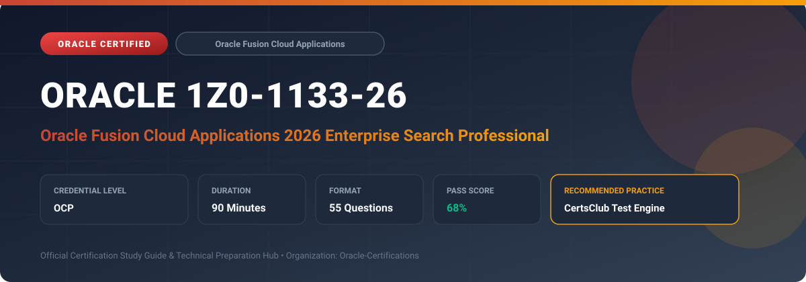

  

# Oracle 1Z0-1133-26: Oracle Fusion Cloud Applications 2026 Enterprise Search Professional

---

## 1. Exam Overview & Candidate Profile

The **Oracle 1Z0-1133-26: Oracle Fusion Cloud Applications 2026 Enterprise Search Professional** certification validates specialists responsible for configuring, optimizing, and securing enterprise search across Oracle Fusion Cloud Applications.

Candidates validate expertise across global search architecture, Elasticsearch/OpenSearch indexing in Fusion, search configurations, relevance tuning, data security filtering, facets, and user discovery analytics.

### Target Audience & Prerequisites
- **Target Roles**: Implementation Specialists, Cloud Architects, Technical Leads, Enterprise Consultants, and Systems Engineers.
- **Recommended Experience**: 1–2 years of practical, hands-on experience designing, implementing, and maintaining corresponding Oracle solutions.
- **Credential Earned**: OCP Certification.

---

## 2. Key Exam Specifications

| Specification | Details |
| :--- | :--- |
| **Exam Code** | **Oracle 1Z0-1133-26** |
| **Official Title** | Oracle Fusion Cloud Applications 2026 Enterprise Search Professional |
| **Certification Track** | Oracle Fusion Cloud Applications |
| **Exam Duration** | 90 Minutes |
| **Number of Questions** | 55 Questions |
| **Passing Score** | 68% |
| **Question Format** | Multiple Choice (Single/Multiple Answer), Scenario-Based Questions |
| **Delivery Provider** | Oracle University / Pearson VUE (Online Proctored or Test Center) |
| **Recommended Practice Engine** | [CertsClub Oracle Practice Tests](https://www.certsclub.com/oracle/1z0-1133-26-dumps.html) |

---

## 3. Official Blueprint & Exam Domain Breakdown

The examination assesses candidate competencies across core functional domains weighted as follows:

| Domain Area | Weighting |
| :--- | :--- |
| **Fusion Enterprise Search Architecture & Indexing Engine** | `25%` |
| **Configuring Searchable Business Objects & Categories** | `25%` |
| **Search Relevance Tuning, Synonyms & Boosting** | `20%` |
| **Data Security, Role-Based Access & Privacy in Search** | `15%` |
| **Monitoring, Index Maintenance & Search Analytics** | `15%` |

---

## 4. Deep Dive into Complex & Challenging Technical Topics

To secure a passing score on the 1Z0-1133-26 exam, candidates must master the following advanced concepts:

- Understanding the search pipeline: database change tracking, pipeline ingestion, OpenSearch indexing, and query evaluation.
- Enabling searchable business objects across HCM, ERP, SCM, and CX modules.
- Configuring search filters, facets, autocomplete suggestions, and keyword boosting rules.
- Ensuring data security: index-time versus query-time security predicate enforcement based on user roles.
- Running ingestion scheduled processes, rebuilding search indexes, and diagnosing search latency.

---

## 5. Scenario-Based Demo & Practice Questions

### Question 1
How does Oracle Fusion Enterprise Search ensure that users only view search results for records they are explicitly authorized to access according to Fusion data security policies?

A) Injecting user security grants and role filters into the query pipeline so unauthorized records are excluded before display
B) Displaying all records and asking the user not to click them
C) Creating a separate search engine cluster for each employee
D) Restricting search to administrators only

- **Correct Answer**: `A) Injecting user security grants and role filters into the query pipeline so unauthorized records are excluded before display`  
- **Technical Explanation**: Fusion Enterprise Search integrates deeply with Oracle Fusion Applications Data Security. User entitlements are dynamically applied as query filter predicates to guarantee strict role-based data isolation.

---

### Question 2
What administrator scheduled process is executed to refresh and resynchronize business object data from the transactional database into the Elasticsearch index in Fusion Applications?

A) ESS job to create index definition and perform initial ingest to OSCS
B) Purge Log and System Activity
C) Compile Master Chart of Accounts
D) Run Database Reorganization

- **Correct Answer**: `A) ESS job to create index definition and perform initial ingest to OSCS`  
- **Technical Explanation**: The 'ESS job to create index definition and perform initial ingest to OSCS' (Oracle Search Cloud Service) rebuilds and repopulates the search index for designated searchable objects.

---

## 6. Recommended Preparation Strategy & Practice Testing Engine

Achieving certification in **Oracle 1Z0-1133-26** requires balanced theoretical study and scenario-based simulation practice:

1. **Review Oracle Documentation**: Master architecture guides, implementation workbooks, and administration manuals on the Oracle Help Center.
2. **Hands-on Lab Practice**: Execute real-world configuration, policy setup, and troubleshooting tasks in your cloud tenancy or test instance.
3. **Simulated Exam Drills**: Practice answering timed, scenario-based multiple-choice questions to familiarize yourself with the question formats, traps, and timing constraints.

### Practice With CertsClub
For realistic practice questions, updated dumps, and mock testing environments:
- **Resource**: [CertsClub Oracle Practice Test Engine](https://www.certsclub.com/oracle/1z0-1133-26-dumps.html)
- **Special Discount**: Use coupon code **`club20`** during checkout for an instant **20% discount** on all practice exam bundles and testing engines.

---

## 7. Official Documentation & References

- [Oracle University Certification Registry](https://education.oracle.com/)
- [Oracle Help Center Documentation Portal](https://docs.oracle.com/)
- [Oracle Cloud Infrastructure & Applications Guides](https://docs.oracle.com/en/cloud/)
- [CertsClub Oracle Certification Exam Practice](https://www.certsclub.com/oracle/1z0-1133-26-dumps.html)

---

## 8. SEO & Discovery Keywords

`oracle 1z0-1133-26, oracle 1z0-1133-26 exam, oracle 1z0-1133-26 dumps, 1Z0-1133-26 practice questions, 1Z0-1133-26 study guide, oracle fusion cloud applications 2026 enterprise search professional, certsclub 1z0-1133-26`